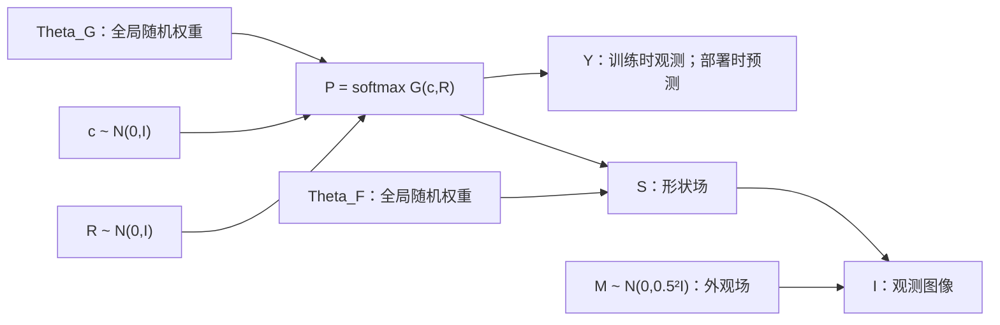

# BayeSeg＋G：生成器条件化的解剖联合后验与匹配实验方案

2026-10-21。**文献与方法设计交付；尚未实现、训练或验证的新方法。用户明确要求先不启动训练。** 本报告不改变旧实验协议、不重启旧进程、不重置原24小时预算。完整阅读范围与论文边界见 [全文阅读记录](BAYESEG_G_FULLTEXT_REVIEW_ZH.md)。

## 1. 核心判断与研究问题

继续保留 G。关闭的是此前固定 G＋R32＋双视图 JS 的特定修补配置，不是 BayeSeg 或生成解剖主线。旧固定接口实验没有隔离 G 学习不足和后验近似不足，也没有建立随机局部变量相对均值模型的额外收益。因此，新方法必须同时允许学习 G，并对后验结构和权重 Bayesian 化分别进行匹配检验。

本方案只提出一个核心机制：**利用当前 G 中全局解剖代码 c 与局部残差 R 的共同注入位置，构造图像条件、生成器条件的联合后验，表达两者的解释竞争。** 不再把翻转一致性、辅助教师、flow、能量模型、递推记忆等一起装入模型。形状—外观—图像路径是 BayeSeg 基础建模部分，不单独包装成创新。

这里“解剖对应”是观测图像与生成解剖潜变量之间的概率对应，不是已建立的跨患者稠密配准，不输出有医学可识别性保证的点对应。G/F 是本项目的扩展记号，不是官方 BayeSeg 中两个可直接提取的同名网络。原论文建模局部变量的 Bayesian 性不自动意味着其网络权重采用 BNN 后验。

## 2. 生成模型与 PGM

记 I 为图像、Y 为四类标签，P 为四类概率，S 为形状相关图像场，M 为外观场。c∈R16；R∈R(16×32×32)。Theta_G、Theta_F 为跨图像共享权重；每幅图有独立 c、R、S、M。P 是确定性节点，不另加一份分类潜变量或第二个标签似然。



这是 BayeSeg 的图像/标签联合建模思想的生成扩展；不是原 PGM 的逐项复刻。它将原分割统计替换为可学习的解剖生成分布，并保留图像分解路径。原 BayeSeg 的 Gamma 边界变量没有被声称逐个保留；这里使用下述可归一化的折叠尺度混合模型。

生成分解为：

\[
p(\Theta_G)p(\Theta_F)\prod_n p(c_n)p(R_n)
 p_{\Theta_F}(S_n\mid P_n)p(M_n)p(I_n\mid S_n,M_n)
 \prod_{i=1}^{N}P_{ni,Y_{ni}},\quad P_n=G_{\Theta_G}(c_n,R_n).
\]

N=128²。无标签时最后一项边缘化为1，但本轮不访问未标注集，不将此性质当作已验证的 SSL 方法。

**G 精确定义。** 保留现有空间生成器的算子顺序：c 经 Linear(16,256)、ReLU、reshape(16,4,4)、直接 bilinear 到128形成 A_theta(c)；R 直接 bilinear32→128，与 A 相加；经 ReLU、Conv3×3(16,16)、ReLU、Conv3×3(16,3) 得三个前景 logits，背景 logit 固定0，然后 softmax。两次上采样均 align_corners=False。不把4→128悄悄换成4→32→128，后者一般不数值相同。G 有7107个均值参数，Bayesian 版本另有7107个 logsd；并非给 U-Net logits 增加一个无概率含义的后处理模块。

**F 与形状图像项。** F 是 Conv3×3(4,16)→ReLU→Conv3×3(16,16)→ReLU→Conv3×3(16,1)，输出去空间均值，共3057个均值参数。令 D=Id−0.9B，B 为周期四邻域平均；D 可逆，保留 log|det D|。令 e=D[S−F(P)]，每像素 tau~Gamma(shape2,rate0.2²)，e_i|tau_i~N(0,tau_i^-1)，折叠得到 proper Student 型密度；它的边际方差为0.2²，而不是把0.2误称标准 t 的 scale 参数。I−S−M 同样用 Gamma(shape2,rate0.1²) 的独立尺度混合；M~N(0,0.5²Id)。这些常数继承现有归一化原型，不依开发结果重调。形状项的 logdet 不能因梯度为常数而从所报告证据密度中消失。

**权重先验。** G/F 各层权重独立 N(0,0.2²/fan_in)，bias 独立 N(0,0.2²)。学习 Bayesian G/F 时采用对角 Gaussian q(Theta)。两图旧 G 仅是共同优化初始化，不作为读取同一批10患者时的“新先验”，避免先验和训练重复使用相同标签。固定 G 臂则把旧 q_G 作为不可更新的已给定模型分布，报告其两图来源；不将这个固定外部分布解释为本轮从零完成的 Bayesian 更新。固定臂的 q_G 与新先验 KL 是常数，保留数值但不制造额外梯度。

## 3. 核心后验：沿 G 的共同解释方向建立 c—R 依赖

识别器只读取 I。共同 U-Net 输出 f(I)∈R(16×128×128)，保持现有 c/R 参数头：c 通过全局池化及16→32→32头；R 通过32×32池化及1×1卷积16→32。输出分别拆为 mu 和 logsd；logsd=−4+3tanh(raw/3)，保留原范围(−7,−1)。**新方案恢复所有 c/R 方差行的训练**，不继承旧点估计实验冻结800行的规定；这一变化对所有随机局部后验 G 臂一致。

独立基线 I：q(c,R|I,Theta_G)=q(c|I)q(R|I)。CNN 的空间感受野不会使这个分布自动具有相关性。

结构后验 S：

\[
 c=\mu_c(I)+\sigma_c(I)\epsilon_c,\qquad
 R=\mu_R(I)-\kappa(I)[B_{\Theta_G}(c)-B_{\Theta_G}(\mu_c(I))]
       +\sigma_R(I)\epsilon_R.
\]

其中 epsilon 独立标准 Gaussian；kappa=sigmoid(w^T GAP(f)+b)，只增加17个识别参数，w初值0，b=logit(0.01)。这不是新一个解剖生成器，也不要求测试时优化。对 G 的每个权重样本，后验和生成读出使用**同一 Theta_G**。B 的 theta、c 和锚点路径都参与重参数化梯度，不默认 stop-gradient。

B 将 G 的全局特征投影到现有 R 注入空间：令 T 为原 bilinear32→128的一维矩阵，L=(T^T T)^−1 T^T，逐通道定义 B_theta(c)=L A_theta(c)L^T。因此 U(B)=T B T^T 是 A 到 R 可表达注入子空间的最小二乘投影。L 用 FP64 Cholesky 求解后固定为 FP32；不构建16384²协方差，不改变 G 本身。实施前必须检查 T 的满列秩、L T≈Id 和投影残差，失败则停止准入而不是暗换算子。

**为什么这样条件化。** 当 c 增加某个全局结构成分，R 可以相应减少同一注入成分；独立后验不表达这条补偿方向。在线性 B 情况，Cov(c,R|I,Theta)=−kappa Sigma_c J_B^T；非线性时这只是局部线性解释，不能称精确 Gaussian 联合后验。后验也不解决 c/R 的生成不可识别性，尤其不能据此宣称解剖因果分解。

**可计算密度。** 这是三角变换：先采 c，再采 R|c,I,Theta；对噪声的 Jacobian 对角块为 diag(sigma_c)、diag(sigma_R)。非对角依赖不增加 logdet：

\[
 \log q(c,R|I,\Theta)=\log q(c|I)+\log q(R|c,I,\Theta).
\]

\[
 KL_{cR}=KL(q_c\Vert N(0,Id))+
 E_{q_c}\tfrac12\sum_j[\mu_{R|c,j}^2+\sigma_{R,j}^2-1-2\log\sigma_{R,j}].
\]

这里只第二项的均值平方需要对 c/Theta 取 MC；sigma_R 是条件标准差，不能冒称 R 的边际标准差。kappa=0严格退化到独立族，数学包含关系不意味着有限训练优化一定更好。

**完整变分分解。** q(Theta_G)q(Theta_F)∏q_phi(c|I)q_phi(R|c,I,Theta_G)q_phi(S|I)q_phi(M|I)。S/M 用同一 backbone 的两个1×1(16,2) Gaussian 头，额外共68参数；采用同一 logsd 映射。这是本方案的共享识别器选择，不冒称原 BayeSeg 的两个 ResNet 已被原样复现。基础 H 连 backbone 为484576个可更新标量；加 S/M 头为484644，结构族再加17为484661。unused segmentation_head 冻结。G/F 参数另外统计，不混入这些数。

部署分割只需要 q(c,R|I,Theta_G) 和 G；F、S/M 的作用是训练时将图像证据与 P 相连，部署不会运行 GT 条件推断或逐患者优化。近似预测为 E_q P，而不是精确 p(Y|I,D)。训练含 Dice，因此最终 q 也不声称是普通 Bayesian 后验的精确解。

## 4. 目标：保留原 CE/Dice，正确标注 Bayesian 部分

每图每次训练使用2个 G 权重样本×2组局部噪声，共4份 P。F 权重同样2份，S/M噪声2份；不同噪声流分开，不因确定性 G 取消 Theta 抽样而改变局部噪声序列。

\[
 CE_n=\frac1{4N}\sum_{s=1}^4\sum_i-\log P^{(s)}_{ni,Y_{ni}},\qquad
 \bar P_n=\tfrac14\sum_s P_n^{(s)}.
\]

\[
 Dice_n=\frac1{|C_n^+|}\sum_{k\in C_n^+}
 \left[1-\frac{2\sum_i\bar P_{nik}1[Y_{ni}=k]+10^{-6}}
 {\sum_i\bar P_{nik}+\sum_i1[Y_{ni}=k]+10^{-6}}\right].
\]

C_n^+ 只含该图 GT 存在的前景类；每类等权；无前景图 Dice=0；缺类仍受原 CE 约束。**不改成 mixture CE，不改逐 draw Dice，不做类别重加权，不重复加入标签似然。** 直接 U-Net 的 CE/Dice 使用同一个定义，概率没有 MC 随机性时自然退化。

令 A_n=E[log p(I|S,M)+log p(S|P,Theta_F)+log p(M)−log q(S|I)−log q(M|I)]，则每图损失为 CE+Dice+(KL_cR−A_n)/N，加全局权重 KL/(230N)。图像项系数1，无 beta 搜索、KL warmup 或新 JS。直接辅助臂 U_F 使用相同 A_n 但没有 c/R KL。纯 U 臂只有 CE+Dice。

患者均衡采样的图像分布为 w_n=1/(10 m_patient)，而不是230图均匀。为保持原采样且不伪称普通 iid 后验，本方案明确采用**患者加权的广义 Bayesian 变分目标**：a_n=230w_n，最大化 L_w=E_q∑a_n[log p(I_n,Y_n,locals|Theta)−log q(locals|I_n,Theta)]−KL_global（局部熵以正号加入）；除230N后得到上述采样估计。另加原 Dice 后是 task-regularized variational learning，不是纯 ELBO，也不是通过 Dirac 零方差构造出的 KL。A_n 和标签 CE 的重复计数必须在实现审计中排除。

确定性 G 以相同 Gaussian 先验下的 −log p(theta_G)/(230N) 做 MAP 正则，采用点参数优化，**不计算 Dirac 对连续 Gaussian 的 KL**。F 仍 Bayesian，c/R/S/M 仍随机；“确定性 G”不等于整个模型确定性。权重 KL 与 MAP 数值不能被说成同一罚项。

## 5. 匹配实验：十臂，分别回答三个问题

以下为设计冻结稿，非已部署协议。全部从相同 backbone/H 初态、G 同一旧两图初始化出发，fresh Adam；不连接任何终态。固定 G 和学习 G 的差异是能否更新同一生成状态，不是偷偷换更大 G。

|臂|G权重|c/R后验|F/图像因子|回答的问题|
|---|---|---|---|---|
|U|无；直接四类头|无|无|原 U-Net＋原 CE/Dice|
|U_F|无；直接四类头|无|学习 Bayesian F|图像辅助目标本身的收益|
|FG_I|固定旧 q_G|独立 I|同 U_F|给定旧解剖模型的匹配控制|
|BG_I|学习 q_G|独立 I|相同|BG_I−FG_I：学习 G 的贡献|
|BG_S|学习 q_G|上述结构 S|相同|BG_S−BG_I：主后验机制|
|DG_I|学习 MAP G|独立 I|相同|权重分布的匹配控制|
|DG_S|学习 MAP G|结构 S|相同|BG_S−DG_S 与2×2交互|
|BG_S_shift|学习 q_G|结构 S，但 B 在固定循环移位后的 c 坐标求值|相同|生成器与后验依赖方向对齐的机制控制|
|NP_S|学习G均值，固定非后验Gaussian扰动|结构 S|相同|学习后验是否超过普通训练扰动|
|BG_P|学习 q_G|c/R取均值，保留均值先验罚|相同|新可学习G下，局部分布是否超过匹配点估计|

shift 为16维 c 循环移位1，锚点也移位；实际生成 P 仍用原 c。它不增加参数，执行相同 A/投影运算。该控制可能通过联合训练部分适配，不能保证是无信息“错误解剖”；它只能检验特定对齐方向的必要性。若它与主方法同样有效，不宣称当前 G 条件几何具有特异增量。通用结构化 VI 已有大量先例，不能靠独立后验一个弱对照宣称首次。

BG_P 使用独立族的均值头、相同初态和数据；800个方差专属输出行及Adam矩冻结，仅有效均值路径学习。用0.5(||mu_c||²+||mu_R||²)/N替代局部KL，不加局部熵；不是Dirac KL或普通局部VI。G/F权重仍随机。训练每步2Theta×1local，评价4Theta×1local，不做重复相同local的无用前向；因此实际G调用更少如实报告。BG_S−BG_P检验结构化局部分布是否超过均值正则，不能用历史固定G的Dmu直接替代这个新对照。其识别部分有效更新483844标量，优化器槽484644；800行值/grad/Adam矩必须精确冻结。

NP_S 保持与 BG_S 相同采样槽与初态均值，扰动标准差固定为共同旧G初始化的标准差；仅学习均值，使用同 DG 的均值 MAP 罚，不学习方差、不加 Gaussian 熵项。此初始尺度来自历史模型，明确是固定扰动参照，不称通用最优噪声；不按开发集匹配或扫幅度。主评价同样做随机扰动平均及均值次读出，比较 BG_S−NP_S 和 NP_S−DG_S。若普通扰动复现效果，不能称后验分布有特异收益；即使 BG_S 更好也只支持这组已冻结对照，不能证明校准不确定性或所有噪声族都较差。

两个 U 臂的直接头68参数；U 482500、U_F 482568。G 族的基础识别头相比 U 多2076参数，S 再多17；不叫参数完全相同。U_F 控制 F/图像辅助，G 的2×2比较控制权重类型与后验族，报告参数、调用数、显存、实际训练/部署秒数；相同步数不等于同算力。若要声称更高算力效率，必须另有冻结的 wall-time/FLOP 匹配实验，本设计不预先作该主张。

## 6. 训练、初值与执行前准入

只原10 Siemens20%标注患者230切片；开发23患者46相位544切片。test24、U38、目标域不读。23患者此前反复使用，只提供开发证据，不用新五折把它改称独立测试。没有新训练 seed 扫描、教师、EMA、F族搜索、未标注学习或持续学习。

每臂5000主更新/反向，共50000；每臂0/1000/.../5000保存6份完整 model/Adam/RNG，共60。同原患者均衡 batch2、四翻转增强、schedule5001..10000；Adam lr3e−4/betas(.9,.999)/eps1e−8/wd0/foreachFalse/clip1；FP32 deterministic、TF32False、CUBLAS=:4096:8。单视图训练，没有新增双视图 JS；不改变原 CE/Dice。

G/H 取已有 step0、空opt源；F 各臂共同使用一次指定初始化(seed726163，仅网络初始化，不是新增训练seed重复)。q_F均值 He 初始化、bias0，权重 logsd 对应先验标准差；S/M头权重和均值bias0，rawsd bias0(logsd−4)；其余同源。G q初值直接复用共同旧状态，MAP G取其均值。全部先验为本报告明确的数据独立先验，不把历史 posterior buffer 当新 prior。正式实施前必须逐项写来源、尺寸、参数名、Adam空状态及先验常数回执，缺源就不启动，不擅自替换初态。

准入必须在**后续获准实施时**验证：G与旧接口同输入前向一致；kappa=0与独立 loss/gradient一致；条件 logq 与三角 Jacobian一致；projection合法；所有图像概率归一化；Student密度常数/logdet与熵符号正确；CE/Dice逐项回放；所有应学习 G/F/方差参数有有限梯度；固定 G 无更新。此文档阶段不运行这些网络准入，不将待做检查写成 PASS。

正式每步联合更新识别器、允许学习的 G 和 F，一次主反向，不另加内循环/局部SVI/交替额外更新。联合学习可能产生 moving-target 问题；其失败不能被主观归为“需要无限多 H 步”。任何改用交替更新都另立协议，不能用不同额外推断预算替代本对照。

### 6.1 算法与状态更新

```text
输入：同源backbone/H/G初态、共同F初始化、固定先验和5000条患者调度
对每个实验臂：创建独立freshAdam，恢复共同初态RNG，保存S0000
  对step=1..5000：
    读取原batch2及原增强；仅图像送入H得到局部后验参数
    依臂选择固定q_G、学习q_G、MAP G或固定尺度扰动；抽2份权重
    对每份权重：计算一次A(mu_c)锚点；抽2组局部c、R、S、M
      结构臂按当前G计算条件R；独立臂条件补偿系数0
      G产生P；F(P)进入形状密度；计算图像似然、局部logq/先验
    BG_P只做2份权重×1局部均值；U臂不制造冗余G调用
    逐draw CE平均；Dice对全部P平均后算；加入完整图像项和KL/MAP
    一次反向、clip1、一次Adam；记录每项loss、所有实际调用与梯度异常
    按固定节点保存完整model/Adam/RNG；不按开发集挑终态
所有臂训练完成：先image-only预测及封存，再共享GT评分、温度拟合与独立审计
```

G的Bayesian更新同时接受显式生成读出路径及条件q路径的梯度；不能只更新H却报告“学习G”。局部结构族没有测试时迭代，也没有训练GT优化出的q充当部署教师。

## 7. 预测封存、风险对照与主要统计

每臂10训练患者20相位230切片＋23开发患者46相位544切片，原图像输入。主读出 G 采用4权重槽×4局部噪声=16概率平均；MAP G 的4权重槽复用相同权重，但局部噪声仍16份；FG 使用原固定 q_G。U 两臂一次输出。BG_P使用4Theta×1local主读出，保留同样的概率平均规则。全部 G 臂还保存权重均值＋局部均值单次读出作次要效率/采样对照，不能按 GT 挑更好读出替换主终点。

原 seed620163+1000phase+batch，Theta_G、Theta_F、c/R、S/M 分离流；形状不同的臂不能声称每个变换后样本相同。q条件锚点每Theta每batch缓存，并在16次采样内复用；qS/M和F不需要在部署分割时运行。固定网络/eval/gradFalse，纯图像预测，所有主和次要 native128 FP32输出及清单封存后才读取本轮评分标签。

恢复原GPU deterministic bilinear至384、归一化，原processed_spacing和3D phase_metrics、EDES→类→患者规则。不是128网格Dice，不量化。原始NLL为384 mixture NLL；训练期128期望CE单独报告，不混表。全患者/相位 LV/MYO/RV Dice、宏Dice、HD95缺失与空预测惩罚、NLL/Brier、类别条件NLL/自然贡献及FP/FN/RV TP>0→0完整保留。

10臂均用原相同患者五折温度：排序mod5，stride64、phase等权、logT[-3,3]、bounded xatol1e−5/maxiter64；共50fits≤3200函数请求，实际nfev记账。最终384混合概率变换softmax(logp/T)，fit不含评分患者、所有T先封存、manifest先于该次heldout标签重读；argmax变化0。它是开发集内交叉校准，不是网络0优化或独立test。

**唯一首要机制比较：BG_S−BG_I 的开发患者宏Dice。** 同时完整报告其匹配校准NLL/Brier与新增RV真实TP丢失。关键次要比较为 BG_I−FG_I（学习G），BG_S−DG_S 及(BG_S−BG_I)−(DG_S−DG_I)（权重Bayesian×后验族），BG_S−U_F、U_F−U、BG_S−BG_S_shift、BG_S−NP_S、BG_S−BG_P。95%配对患者bootstrap10000 seed163，NA需报告共同有效数。多比较为探索性，不把23×配置当独立样本，也不把患者CI叫seedCI或MC区间。

继续投入的工程门槛预先固定：主Dice点增益≥0.5pp且患者CI下界>0；没有新增 control RV TP>0而methodTP=0；MYO/RV召回点下降均不超过1pp。门槛只决定是否值得另立重复研究，不构成非劣/临床证明。若只ELBO改善、或降低分歧但丢真RV，不晋级。若学习G有益而结构后验无益，保留学习G、关闭此后验假设；若确定性G复现收益，保留G方法但撤回权重Bayesian增量。若BG_S与shift相当，只支持更一般相关后验而非生成器对齐特异机制。若BG_P复现BG_S的分割和风险，则不保留局部分布贡献主张。

## 8. 预算与独立审计

设计总50000主optimizer/reverse、60完整状态、100000训练编码图像；原7个随机局部G臂140000批量G，BG_P另10000，共150000批量G/300000图像G。9个带F臂每步4F共180000批量F/360000图像F。U/U_F共10000直接logit批量调用。5个BayesianG臂加1个固定扰动臂各step2随机权重，共60000随机Theta_G（其中10000是非后验噪声）；9个F臂共90000 Theta_F。G族全局A锚点/投影另账，BG_P无条件补偿锚点；独立族执行对应匹配锚点计算但系数0。参数更新数相同不是严格算力匹配。

主评价10×774=7740编码图像；7个随机局部G臂44576批量G，BG_P另1592，共46168批量G/89784图像G；U两臂796直接logit。5个BayesianG臂共7960 Theta_G，NP另1592非后验扰动，MAP臂0随机权重。8个G臂次要mean读出另3184批量G/6192图像G，共用当批特征，不新增编码。主660相位＋次要528相位=1188份native概率，理论3652190208bytes。主评分660恢复、按相位共享66次GT；校准另460恢复、共享46次GT，共112标签读取；次要528恢复复用原相位GT。存储含60状态、源码日志与保守余量预留7GB，不能删除旧证据或将未保存概率的限制隐去。

审计必须独立核50000连续账本/60状态/初态及schedule、所有实际学习/冻结参数、联合目标、q密度、1188封存及评分时序、全部风险/配对统计、50fits真实成本及隔离、EXIT/FAILURE和worker/guard退休；网络回放若未做就不称独立网络复演。只PID消失不是完成。故障保留partial及真实成本，不能从头盲重跑。

**当前执行状态 DESIGN_ONLY_NO_TRAINING。** 上述预算是未来方案，不代表现有原24h仍有足够时间。本次不设置新clock、不创建运行目录、无训练/GT评分/拟合。原链首启、历史118400Adam及全部失败成本继续保留，原24h上限不变；到限不能拿本报告的“新方案”重置延长。只有用户后续允许实施，且实际来源、完整预算、剩余时间与守护均准入，才可部署。旧18/20GB已解除，仍新增实际<50GB及适用45/49GB守护；不能以旧软限停工，也不能绕原时钟开工。

## 9. 创新主张与能证伪它的结果

可主张的是一个待验证的**模型对应后验设计**：用既有 G 的全局/局部共同注入算子构造可归一化、低成本、生成权重条件化的 c—R 后验，并在 BayeSeg 图像—形状—语义联合模型中同时学习 G。三角后验、结构化VI、Gaussian权重和图像重构都不是单独新颖点；当前文献检索不能证明“首个”或排除所有先例。

与 Pro 的关系：两份分享分析强调先把分割、风险和采样扰动分开，匹配控制不可省，旧固定接口不能无限微调；本方案遵守这些原则。最新四臂JS已失败，因此不再次照抄其建议启动。此次局部随机后验是用户明确要求完整 Bayesian 框架后另立的模型假设，不将旧K1的弱证据改写成支持；NP_S对应Pro提出的非后验噪声对照。

与ASVI相比，区别不是把网络换大，而是没有时序邻域链，依赖方向取自本模型 G 的可补偿注入子空间；与AFIN相比，不训练通用typed-factor Transformer或跨模型族推断器；与VEN相比，不假设整体Gaussian或执行精确Gaussian消元；与HiSC相比，不引入EBM符号先验/分区函数，采用密集标签Cat条件；与PoPNet相比，没有VFM谱先验、ROI融合或额外教师。对应全文与限制逐篇列于阅读报告。

最重要的反证包括：学习 G 不如固定 G、结构后验不如独立族、确定性 G 完全复现风险、shift控制复现结构收益、仅训练目标变好而图像分割不变、F外观路径吸收证据后语义仍塌缩。出现这些结果应缩小或撤回机制主张，不能追加模块把同一开发集修到通过。新方法的性能目前未知，旧固定G约72%的开发Dice不是本方法结果。

## 10. 本次实际核验与尚未完成项

本次仅用CPU小矩阵验证条件后验的线性Gaussian特例：32→128上采样Gram最小特征值1.256621，L T与Id最大误差3.33e−16；链式KL与稠密联合Gaussian KL差1.78e−15，三角Jacobian熵项差2.22e−16。首次NumPy BLAS调用出现浮点警告但结果有限，已保留私有记录并用独立einsum乘法复核，后续无警告。它不验证非线性网络、FP32 GPU、统计校准或分割性能；正式网络准入仍全部待实施。

文献和本设计已交付，不等于训练代码已经实现或新方案已有性能。原CE/Dice以现有patient_loss_factor.py的实现逐项核对；设计的PGM、后验密度、MAP/VI边界和调用账本作了文档检查。本轮实际网络前向/反向/optimizer/真实图像或GT读取/温度fit均为0。
